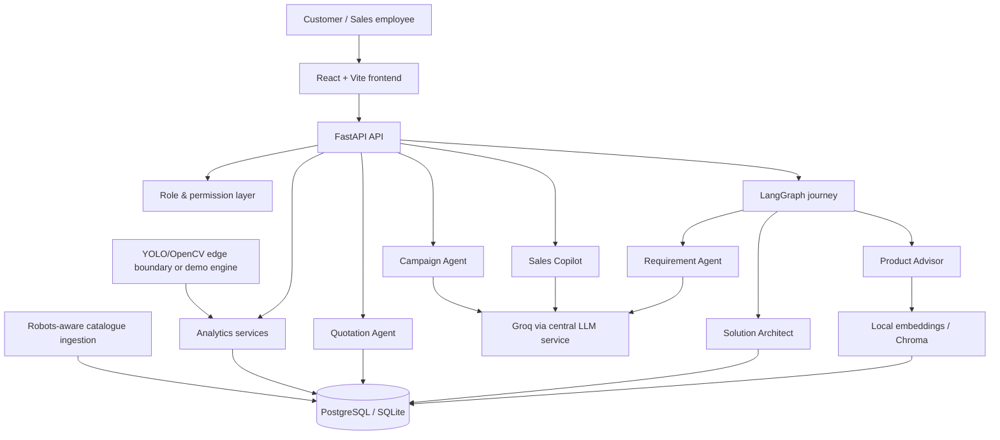

# SignaFlow AI architecture

## System view



## Responsibility boundary

AI is used for language understanding, explanation, summarization, next-action suggestions, communication drafts, campaign copy, and optional analytics narrative.

Application code remains authoritative for:

- authentication, roles, and permissions;
- product identity, price, source, specifications, and availability;
- lead creation/update and deterministic scoring;
- VAT, line totals, subtotal, grand total, and quote state;
- database mutations and analytics calculations;
- approval gates for quotes, messages, campaigns, and schedules.

## Connected graph

The `/api/chat` route builds a LangGraph state machine:

```text
START
  → Requirement Agent
      ├─ missing decision-changing fact → one clarification → END
      └─ enough context → Product Advisor
                              → Solution Architect
                                      → END
```

The individual `/requirements/extract`, `/recommend`, and `/solutions/build` endpoints expose the same stages for a progressive UI. This lets the browser show intermediate structured data without turning the workflow into disconnected demos.

## RAG design

Each product becomes a document containing product name, category, description, use cases, industries, environment, dimensions, material, specifications, and source. Demo mode encodes those documents with a deterministic 384-dimensional signed hashing model entirely on the local machine. The optional production path uses `all-MiniLM-L6-v2` locally and persists embeddings in Chroma.

Retrieval is not the final recommendation. The ranking service combines semantic similarity with explicit industry, environment, use-case, size, budget, and availability signals. The response retains product ID, source, source URL, and retrieval score. No free-text model response can introduce a product that is absent from the database.

## Failure behavior

| Failure | Behavior |
|---|---|
| Missing/invalid Groq key | deterministic requirement, Copilot, and campaign fallback |
| Groq rate limit or timeout | safe log metadata; friendly user response; fallback continues |
| Chroma/MiniLM unavailable | local hashing embeddings |
| Public ingestion unavailable | cached responses or clearly labelled seed data |
| YOLO/OpenCV unavailable | deterministic Smart Signage demonstration |
| Missing product price | `Price to be confirmed`; excluded from calculated grand total and flagged |

## Agent permissions

| Agent | Allowed | Explicitly disallowed |
|---|---|---|
| Requirement Agent | structure customer-provided facts | invent missing facts, mutate CRM |
| Product Advisor | search/get/filter/compare products | invent products, change prices, approve quotes |
| Solution Architect | assemble catalogue products and compatibility checkpoints | promise installation/delivery |
| Sales Copilot | view sales context, draft next actions/messages | send messages, delete leads |
| Quotation Agent | create draft quotes from database products | generate prices, approve or send quote |
| Campaign Agent | create draft copy and layouts | publish or change schedules |
| Analytics Agent | calculate aggregates and suggest experiments | identify people, auto-optimize production |

## Prompt-injection boundary

The central LLM system instruction declares all website, product, document, database, and customer text untrusted. Retrieved text is passed as data only. Tool contracts are fixed in code, validated through Pydantic, and never allow arbitrary code execution, deletion, secret access, quote approval, or publishing.

## Smart Signage boundary

```text
Camera / uploaded demo video
  → YOLO person class only
  → anonymous track IDs
  → configured viewing ROI
  → aggregate entries and dwell windows
  → metrics storage
  → dashboard
```

No face embeddings, facial recognition, identity resolution, or race/religion/health/political/sensitive-attribute inference is part of the design. A real pilot needs a privacy review, retention limits, access controls, and site notices.

